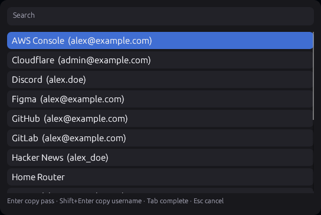
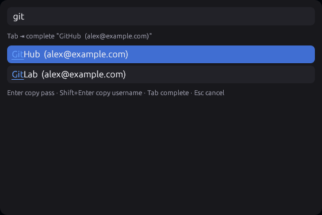
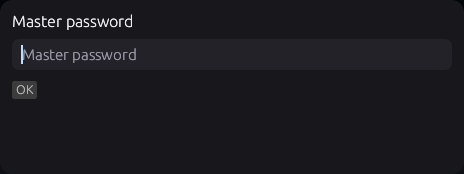
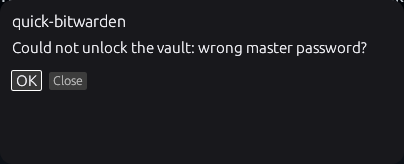

# quick-bitwarden

A quick way to copy your [Bitwarden](https://bitwarden.com/) passwords, with a
fast [r-modals](https://github.com/Kevin-Ramirez127/r-modals) picker.

The picker and every dialog are rendered by **r-modals**
(borderless, searchable, X11 + Wayland), and the vault cache lives in a small
background daemon.

## Screenshots

The screenshots use a synthetic demo vault; all names, usernames and passwords
are fake.

| Picker | Filtered |
| --- | --- |
|  |  |
| **Master password** | **Wrong password** |
|  |  |

## How it works

`quick-bitwarden` is a **background daemon**:

It uses [`rbw`](https://github.com/doy/rbw), the unofficial Bitwarden CLI, to
get your passwords and shows them in an r-modals window so you can select one
and just copy it.

quick-bitwarden starts the daemon and stores the item list in memory so toggling
the window is instant. Passwords are read from `rbw` only when you pick an item,
so a vault locked outside q-bw (for example with `rbw lock`) is enforced
immediately. `rbw` keeps the unlocked keys in its own `rbw-agent`; q-bw never
stores a session token.

Every time the window is hidden, it refreshes the cache only if more than
`QBW_REFRESH_INTERVAL` seconds elapsed (30 by default).

On **Enter** it clears the clipboard first, then fetches the password from
`rbw` and copies it, so an old clipboard entry cannot be pasted while the lookup
is in flight. In the background it **deletes that password** from `cliphist`
immediately, so the clipboard history never keeps it; the password stays on the
current clipboard for `QBW_CLEAR_AFTER` seconds and then is cleared.

The daemon itself never opens a window: each dialog runs in a short-lived child
process, so `hide`/`toggle` can close it from the outside.

Only one daemon and one picker window run at a time. Concurrent launches are
serialised with a lock, and a `show` request that races an already-opening
picker is dropped instead of stacking a second window.

## Requirements

- **rbw** and **rbw-agent**. Install them from your distribution or with
  `cargo install rbw`; see the
  [rbw README](https://github.com/doy/rbw#installation). Both binaries must be
  on the daemon's `PATH` (or next to each other).
- rbw must be configured and logged in at least once:

  ```sh
  rbw config set email you@example.com
  # self-hosted only:
  # rbw config set base_url https://vault.example.com
  rbw login
  ```

  On the official `bitwarden.com` server, rbw may require one
  [`rbw register`](https://bitwarden.com/help/personal-api-key/) per device
  (with a personal API key) before `rbw login` works.

  Keep rbw's `pinentry` setting at its default (`pinentry`). q-bw puts a
  private `pinentry` shim first on the agent's `PATH`, so the master password
  is collected by q-bw's own dialog instead of a terminal prompt.
- A graphical session: **X11 or Wayland** (r-modals uses `eframe`/`egui`).
- A clipboard tool: **wl-copy**, **xclip** or **xsel**.
- Optional: **cliphist** (to keep passwords out of the clipboard history).
- Optional: **notify-send** for the "Copied" notification.

## Install

From source, with a Rust toolchain:

```sh
git clone https://github.com/Kevin-Ramirez127/quick-bitwarden
cd quick-bitwarden
cargo build --release
install -m755 target/release/quick-bitwarden ~/.local/bin/
```

Or:

```sh
cargo install --path .
```

## Usage

```sh
quick-bitwarden          # toggle the window (show/hide)
quick-bitwarden show     # open the search window
quick-bitwarden hide     # hide it (the daemon keeps running)
quick-bitwarden toggle   # explains itself
quick-bitwarden sync     # run `rbw sync` and refresh the daemon cache
quick-bitwarden lock     # lock the vault and drop the cached item list
quick-bitwarden hide-items  # hide the item list until a 3+ character search
quick-bitwarden show-items  # show the full item list again
quick-bitwarden stop     # stop the daemon and lock the vault
quick-bitwarden restart  # restart the daemon (starts it if not running)
quick-bitwarden status   # daemon and vault status
quick-bitwarden status --toggle  # whether the picker is shown or hidden
quick-bitwarden --daemon # internal daemon entry point (for system startup)
quick-bitwarden --version / -v  # q-bw version
quick-bitwarden --help / -h     # list q-bw commands
```

### Search window

- Type the item name (or pick it from the list). Search is case-insensitive.
- **Enter** copies the password and closes the window.
- **Shift+Enter** copies the username instead of the password.
- **Escape** just closes the window.
- The list is sorted by item name, as `rbw` returns it.
- You can also type a name that is not listed and press Enter: it is forwarded
  to `rbw get --field password -- <name>`.

#### Prefixes

Queries that start with `>` are commands, not item names (defined in
`$QBW_BASE/config.toml`, see below). Type the prefix and press **Enter**:

- `>sync` — run `rbw sync` and refresh the daemon cache.
- `>lock` — lock the vault and drop the cached item list.
- `>hide items` — hide the item list until you search for 3+ characters.
- `>show items` — show the full item list again.
- `>restart` — restart the daemon.
- `>stop` — stop the daemon and lock the vault.

#### Shortcuts

Key bindings live in the same `$QBW_BASE/config.toml`, materialised by the
daemon from a built-in template. `{exe}` in an action is replaced with the
running `quick-bitwarden` executable when the file is created (older configs
that still contain `{qbw}` are upgraded in place). By default:

- **Shift+Enter** picks the highlighted item but copies its **username**
  instead of the password.

One file holds both kinds of entries: `[[prefix]]` tables (above) and
`[[shortcut]]` tables. A shortcut can pick the highlighted row with a tag
(`pick = "username"`), or use any
[r-modals](https://github.com/Kevin-Ramirez127/r-modals) target (`option`,
`command`, `shell` + `args`) to add your own bindings. Edit the file and the
next window picks the change up; a malformed file is reported by the picker
instead of being overwritten.

`config.toml` replaces the separate `prefixes.toml`; a leftover `prefixes.toml`
(or `shortcuts.toml`) is migrated into it on the next daemon start.

#### Hiding the item list

`>hide items` (or `quick-bitwarden hide-items`) keeps the vault out of the
default view: the picker starts empty and only reveals items when the search
is meaningful.

- 3 or more characters: normal case-insensitive matching.
- Fewer than 3 characters: only an item whose name is typed **exactly** (or
  its short id) is shown.
- The choice is stored in `$XDG_STATE_HOME/quick-bitwarden/hide_items`
  (falling back to `~/.local/state/quick-bitwarden/hide_items`), so it
  survives `stop`/`restart` and a logout/reboot (and the daemon does not need
  to be restarted to pick it up). A marker left by an older version in
  `$QBW_BASE/hide_items` is migrated automatically. `>show items` removes it.

This is a shoulder-surfing aid, not an access-control boundary: the labels are
still sent to the picker process (which runs as you), and typing an item's name
exactly reveals it. It does not change what `rbw` will return, and it does not
protect against someone who can already run commands as your user.

On tiling compositors (sway/Hyprland), float the window via its app id:

```
for_window [app_id="quick-bitwarden"] floating enable
```

### Sync

The program uses `rbw`'s local cache. To pull the latest changes from your
account run one of:

- `quick-bitwarden sync`, or
- the `>sync` prefix inside the search window.

Both run `rbw sync` and refresh the in-memory cache, so the new items are
available immediately. A notification tells you when the sync starts and
another when it ends. The cache also refreshes on its own once
`QBW_REFRESH_INTERVAL` has elapsed since the last update.

### Lock

To lock the vault and drop the cached items:

- `quick-bitwarden lock`, or
- the `>lock` prefix inside the search window.

This runs `rbw lock`, so the next `show` asks for the master password again.
The daemon keeps running. `quick-bitwarden stop` also locks the vault;
`quick-bitwarden restart` deliberately keeps it unlocked.

## Environment variables

| Variable | Default | Description |
| --- | --- | --- |
| `QBW_BASE` | `$XDG_RUNTIME_DIR/qbw` (fallback `/tmp/qbw`) | Daemon working directory (IPC, pid, config, pinentry shim). It must be a private (`0700`) directory owned by you; q-bw refuses to use one that is not. |
| `QBW_CLEAR_AFTER` | `20` | Seconds the password stays on the clipboard |
| `QBW_REFRESH_INTERVAL` | `30` | Seconds between vault cache refreshes |

## Security

- The master password is never stored by q-bw, passed through an argument
  vector or written to a file. It is read from q-bw's dialog by a private
  `pinentry` shim and sent straight to `rbw-agent` over the pinentry pipe. The
  unlocked keys stay in `rbw-agent`'s memory; `lock` and `stop` run `rbw lock`.
- Core dumps are disabled at startup (`RLIMIT_CORE=0`, inherited by `rbw`,
  `rbw-agent` and the clipboard tools) and q-bw processes are not
  dumpable/ptraceable by other same-user processes (`PR_SET_DUMPABLE=0`).
- A legacy `$QBW_BASE/s` session-token file from the `bw` version is removed on
  daemon startup; the rbw version never creates one.
- Vault passwords are never cached by the daemon or written to disk: each pick
  asks `rbw` for the selected field, so locking the vault elsewhere stops
  further copies immediately.
- On copy: the password is removed from `cliphist` right away (with retries in
  case the watcher writes late) and the current clipboard is cleared after
  `QBW_CLEAR_AFTER` seconds (20 sec by default) by a detached helper, so
  `stop`/`restart` or a daemon crash does not leave it on the clipboard.

## Troubleshooting

- **"Not logged in"**: run `rbw login` (or `rbw register`) first, and check
  `rbw config set email …` if rbw has no account configured.
- **A terminal password prompt appears**: rbw's `pinentry` setting is not the
  default. Run `rbw config set pinentry pinentry`; q-bw shadows that name with
  its own dialog.
- **"agent not running" / the vault stays locked**: run `rbw unlock` once from
  a terminal to check the rbw setup, then `quick-bitwarden restart`.
- **The window doesn't appear**: make sure `rbw` and `rbw-agent` are on the
  daemon's `PATH` and that the daemon runs inside your graphical session (so
  r-modals can reach the display).
- **cliphist is not cleared**: check `cliphist store` with
  `cliphist list | grep <password>`.

## Features

**General**
- [x] Starts with system
- [x] Remove from history clipboard
- [x] Remove from user's clipboard in 20 seconds by default
- [x] Sync the vault from the picker (`>sync`) or with `quick-bitwarden sync`
- [x] Lock the vault from the picker (`>lock`) or with `quick-bitwarden lock`
- [x] Copy the username instead of the password with Shift+Enter
- [x] Install script

**Flags**
- [ ] Preserve the clipboard
- [ ] Change clean clipboard time
- [ ] Don't remove from history clipboard
- [ ] No notifications

## License

This project is licensed under the MIT License - see the
[LICENSE](LICENSE) file for details.
